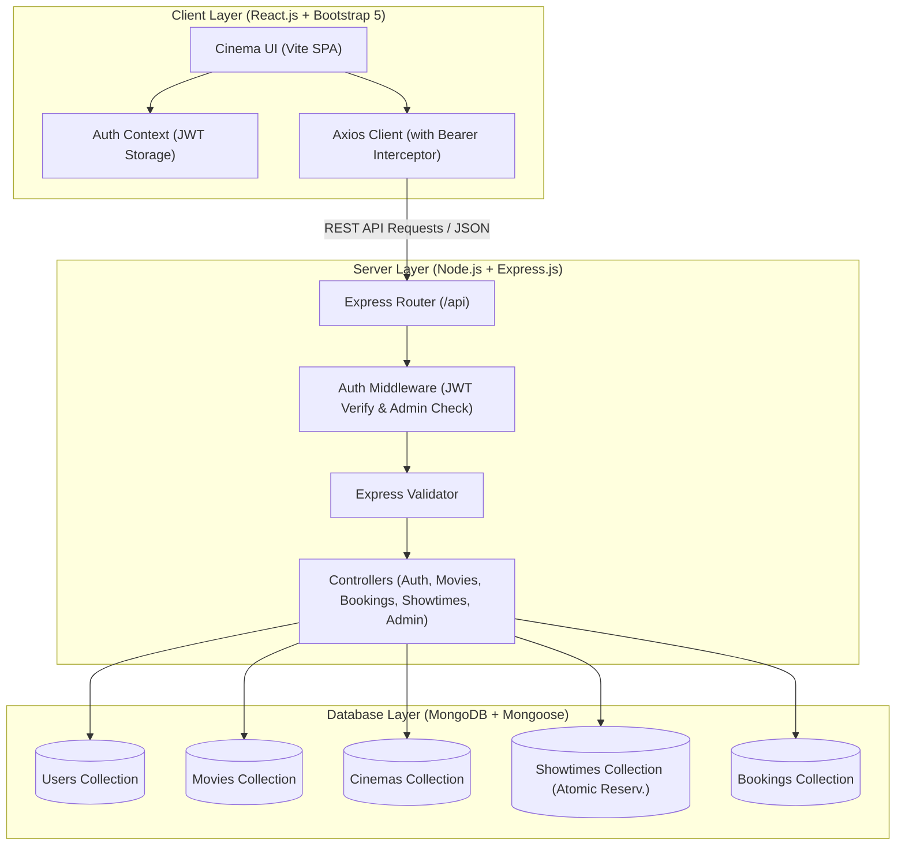

# 🎬 IMovies – Movie Ticket Booking Made Simple (MERN Stack)

A full-stack, production-grade **MERN (MongoDB, Express.js, React.js, Node.js)** Movie Ticket Booking web application designed as a complete college capstone project.

IMovies replicates a real-world cinema booking experience (similar to BookMyShow / Fandango / AMC) with a dark cinema-inspired visual theme, live showtimes, real-time interactive cinema seating layouts, atomic mutual-exclusion seat reservations, JWT authentication with role-based access control (RBAC), printable e-tickets, and a full administrative dashboard.

---

## 📌 Table of Contents

- [1. Technology Stack](#1-technology-stack)
- [2. System Architecture](#2-system-architecture)
- [3. Key Features](#3-key-features)
- [4. Project Folder Structure](#4-project-folder-structure)
- [5. Getting Started (Installation & Setup)](#5-getting-started-installation--setup)
- [6. Demo Accounts & Credentials](#6-demo-accounts--credentials)
- [7. REST API Documentation](#7-rest-api-documentation)
- [8. Atomic Seat Reservation Strategy](#8-atomic-seat-reservation-strategy)
- [9. Testing Guide & Postman Collection](#9-testing-guide--postman-collection)
- [10. College Capstone & Viva Presentation Guide](#10-college-capstone--viva-presentation-guide)
- [11. Troubleshooting Common Errors](#11-troubleshooting-common-errors)

---

## 1. Technology Stack

| Layer | Technologies Used |
| :--- | :--- |
| **Frontend** | React.js (Vite), React Router v6, Axios, Canvas Confetti |
| **Styling & Icons** | Bootstrap 5, Bootstrap Icons, Custom Cinema CSS (Dark theme) |
| **Backend** | Node.js, Express.js, Morgan (HTTP logging), CORS, Dotenv |
| **Database** | MongoDB with Mongoose ODM |
| **Security & Auth** | JSON Web Tokens (JWT), Bcrypt.js (Password Hashing), Express Validator |
| **Testing** | Automated Node.js HTTP Test Suite, Postman Collection |

---

## 2. System Architecture



---

## 3. Key Features

- **🎬 Dynamic Movie Catalog:** Browse *Now Showing* and *Upcoming* blockbusters with real-world high-resolution movie posters, trailers, genres, ratings, and certificates.
- **🔍 Advanced Search & Multi-Filters:** Filter movies instantly by title search, genre pills, language, and sort by rating or release date.
- **📍 Cinema & Showtime Aggregator:** Showtimes grouped by cinema location, screen format (*IMAX with Laser*, *4DX Motion*, *Standard 2D*), and date picker (*Today*, *Tomorrow*, *+2 Days*, *+3 Days*).
- **🪑 Visual Cinema Seating:** Interactive cinema seating map with tiers (*Silver*, *Gold Class*, *VIP Recliners*), screen curvature graphics, aisle dividers, and real-time seat availability.
- **⚡ Guaranteed Atomic Reservation:** Backend enforces single-operation mutual exclusion (`findOneAndUpdate` with `$nin`). If two customers attempt to book the exact same seat at the same millisecond, only the first request succeeds; the second receives an atomic `409 Conflict`.
- **🎟️ Digital E-Ticket Pass:** Printable cinema ticket stub with notch cuts, unique booking reference (`IMV-xxxx`), seat badges, and gate-scan QR simulation.
- **🛡️ Secure JWT Authentication:** User registration, bcrypt-hashed passwords (10 salt rounds), secure token storage, and automatic session restoration.
- **👑 Full Administrator Control Center:**
  - Real-time revenue analytics, booking counts, active movie count.
  - Full CRUD operations for Movie records (Add, Edit, Delete).
  - Cinema & Screen hall layout inspection.
  - Schedule new movie showtimes with custom pricing tiers.
  - Inspect all customer transactions & cancellations.
- **↩️ Cancellation & Automatic Seat Release:** Customer can cancel a booking prior to showtime; the backend automatically unreserves seats and issues a refund status.

---

## 4. Project Folder Structure

```text
Imovies Ap/
├── IMovies.postman_collection.json    # Postman API Collection
├── package.json                       # Root script orchestrator (concurrently)
├── README.md                          # Complete documentation
│
├── server/                            # Node.js & Express Backend
│   ├── .env                           # Local environment config
│   ├── .env.example                   # Environment template
│   ├── package.json                   # Server dependencies & scripts
│   ├── test-suite.js                  # Automated 8-step backend test suite
│   └── src/
│       ├── server.js                  # Express application entry point
│       ├── config/
│       │   └── db.js                  # Mongoose MongoDB connection
│       ├── models/
│       │   ├── User.js                # User schema (roles: user, admin)
│       │   ├── Movie.js               # Movie schema & search indexes
│       │   ├── Cinema.js              # Cinema, screen & tier layout schema
│       │   ├── Showtime.js            # Showtime & atomic bookedSeats schema
│       │   └── Booking.js             # Booking transactions schema
│       ├── controllers/
│       │   ├── authController.js      # Register, login, getProfile
│       │   ├── movieController.js     # Search, filter, CRUD movies
│       │   ├── cinemaController.js    # Cinema list & details
│       │   ├── showtimeController.js  # Showtime & live seat map
│       │   ├── bookingController.js   # Atomic booking & cancellation
│       │   └── adminController.js     # Dashboard metrics & analytics
│       ├── middleware/
│       │   ├── authMiddleware.js      # JWT protect & admin role check
│       │   ├── errorMiddleware.js     # Centralized error handler
│       │   └── validationMiddleware.js# Express-validator error checker
│       ├── routes/
│       │   ├── authRoutes.js
│       │   ├── movieRoutes.js
│       │   ├── cinemaRoutes.js
│       │   ├── showtimeRoutes.js
│       │   ├── bookingRoutes.js
│       │   └── adminRoutes.js
│       └── seeds/
│           └── seedData.js            # Database seeding script (Sample data)
│
└── client/                            # React.js Frontend (Vite)
    ├── index.html                     # HTML root & Google Fonts
    ├── package.json                   # Client dependencies
    ├── vite.config.js                 # Vite config with backend proxy (/api)
    └── src/
        ├── main.jsx                   # React root, Router & AuthProvider
        ├── App.jsx                    # Route declarations
        ├── index.css                  # Custom Dark Cinema CSS Theme
        ├── api/
        │   └── axiosConfig.js         # Axios instance with JWT interceptor
        ├── context/
        │   └── AuthContext.jsx        # Authentication context state
        ├── components/
        │   ├── common/
        │   │   ├── Navbar.jsx         # Cinema header navbar
        │   │   ├── Footer.jsx         # Cinema footer
        │   │   ├── LoadingSpinner.jsx # Cinema loading spinner
        │   │   └── ProtectedRoute.jsx # Route protection & RBAC guard
        │   └── movies/
        │       └── MovieCard.jsx      # Movie card component
        └── pages/
            ├── HomePage.jsx           # Hero carousel, Now Showing, Upcoming
            ├── MoviesPage.jsx         # Catalog with live search & filters
            ├── MovieDetailsPage.jsx   # Movie details, cast & showtimes picker
            ├── SeatSelectionPage.jsx  # Interactive seat layout & checkout
            ├── BookingConfirmationPage.jsx # E-ticket pass & print view
            ├── MyBookingsPage.jsx     # Booking history & cancellations
            ├── LoginPage.jsx          # Login with 1-click Demo Fill buttons
            ├── RegisterPage.jsx       # User registration with validation
            ├── AdminDashboardPage.jsx # Full Admin panel & CRUD management
            └── NotFoundPage.jsx       # 404 Scene Not Found page
```

---

## 5. Getting Started (Installation & Setup)

### Prerequisites

- **Node.js:** v18.0.0 or higher (`node -v`)
- **MongoDB:** Local MongoDB Server running on `mongodb://127.0.0.1:27017` OR a MongoDB Atlas cluster URI.

> **Windows PowerShell Tip:** If PowerShell blocks npm script execution (`PSSecurityException`), run commands in `cmd.exe` or prefix commands with `cmd /c`.

---

### Step 1: Install Dependencies

From the project root directory, install the dependencies:

```bash
# 1. Install root dependencies
cmd /c "npm install"

# 2. Install server dependencies
cmd /c "cd server && npm install"

# 3. Install client dependencies
cmd /c "cd client && npm install"
```

---

### Step 2: Configure Environment Variables

The backend configuration is already present in `server/.env`. If you want to use MongoDB Atlas instead of local MongoDB, update `MONGO_URI`:

```env
PORT=5000
NODE_ENV=development
MONGO_URI=mongodb://127.0.0.1:27017/imovies_db
JWT_SECRET=imovies_super_secret_jwt_key_2026_capstone
JWT_EXPIRE=7d
CLIENT_URL=http://localhost:5173
```

---

### Step 3: Seed the Database with Sample Data

Run the database seed script to populate realistic movies (*Dune: Part Two*, *Oppenheimer*, *The Dark Knight*, etc.), cinema halls, screens, and showtimes:

```bash
cmd /c "cd server && npm run seed"
```

---

### Step 4: Run the Application

You can start both the backend server and frontend client simultaneously using concurrently:

```bash
# From the root directory:
cmd /c "npm run dev"
```

Alternatively, open two separate terminal windows:

**Terminal 1 (Backend Server):**
```bash
cmd /c "cd server && npm run dev"
# Server starts at http://localhost:5000
```

**Terminal 2 (Frontend Client):**
```bash
cmd /c "cd client && npm run dev"
# Client opens at http://localhost:5173
```

Now open **[http://localhost:5173](http://localhost:5173)** in your browser!

---

## 6. Demo Accounts & Credentials

The application includes convenient **1-Click Demo Fill** buttons on the Login page (`/login`) for grading and viva demonstrations:

| Role | Email | Password | Permissions |
| :--- | :--- | :--- | :--- |
| **Administrator** | `admin@imovies.com` | `Admin@123` | Full Admin Dashboard, Manage Movies, Showtimes, View All Bookings |
| **Customer 1** | `alex@example.com` | `Password@123` | Browse Movies, Pick Seats, Book Tickets, View Pass, Cancel Booking |
| **Customer 2** | `sarah@example.com` | `Password@123` | Regular customer account |

---

## 7. REST API Documentation

### 🔐 Authentication (`/api/auth`)
| Method | Endpoint | Description | Access |
| :--- | :--- | :--- | :--- |
| `POST` | `/api/auth/register` | Register new user account | Public |
| `POST` | `/api/auth/login` | Authenticate user & get JWT token | Public |
| `GET` | `/api/auth/me` | Get current logged in user profile | Private (Bearer Token) |

### 🎬 Movies (`/api/movies`)
| Method | Endpoint | Description | Access |
| :--- | :--- | :--- | :--- |
| `GET` | `/api/movies` | Get movies (search, filter by genre/lang/status, sort) | Public |
| `GET` | `/api/movies/featured`| Get featured movies for hero banner | Public |
| `GET` | `/api/movies/meta/filters`| Get available genres & languages list | Public |
| `GET` | `/api/movies/:id` | Get single movie details | Public |
| `POST` | `/api/movies` | Create new movie | Private (Admin) |
| `PUT` | `/api/movies/:id` | Update movie details | Private (Admin) |
| `DELETE`| `/api/movies/:id` | Delete movie record | Private (Admin) |

### 🏛️ Cinemas & Screens (`/api/cinemas`)
| Method | Endpoint | Description | Access |
| :--- | :--- | :--- | :--- |
| `GET` | `/api/cinemas` | List all cinema halls | Public |
| `GET` | `/api/cinemas/:id` | Get single cinema & screen layout | Public |
| `POST` | `/api/cinemas` | Create cinema (Admin) | Private (Admin) |

### ⏰ Showtimes (`/api/showtimes`)
| Method | Endpoint | Description | Access |
| :--- | :--- | :--- | :--- |
| `GET` | `/api/showtimes` | List all active showtimes | Public |
| `GET` | `/api/showtimes/movie/:movieId` | Get showtimes grouped by cinema & date | Public |
| `GET` | `/api/showtimes/:id` | Get showtime & real-time booked seats | Public |
| `POST` | `/api/showtimes` | Schedule new showtime | Private (Admin) |
| `DELETE`| `/api/showtimes/:id` | Delete showtime | Private (Admin) |

### 🎟️ Bookings (`/api/bookings`)
| Method | Endpoint | Description | Access |
| :--- | :--- | :--- | :--- |
| `POST` | `/api/bookings` | Create atomic booking & reserve seats | Private (User) |
| `GET` | `/api/bookings/my-bookings` | Get logged-in user's booking history | Private (User) |
| `GET` | `/api/bookings/:id` | Get single booking digital pass details | Private (User/Admin) |
| `PUT` | `/api/bookings/:id/cancel` | Cancel booking & release seats atomically | Private (User) |
| `GET` | `/api/bookings` | View all customer bookings | Private (Admin) |

### 📊 Admin Analytics (`/api/admin`)
| Method | Endpoint | Description | Access |
| :--- | :--- | :--- | :--- |
| `GET` | `/api/admin/stats` | Total revenue, bookings, movie count, recent orders | Private (Admin) |

---

## 8. Atomic Seat Reservation Strategy

### Why this is critical for a College Capstone Project

In real-world ticketing platforms, the most challenging technical problem is **concurrency**: what happens if two users click *"Book Seat C4"* at the exact same millisecond?
If not handled atomically, both users would be charged and issued the same seat (**Double Booking**).

### Our Implementation

Instead of relying on fragile client-side state checks, IMovies uses **MongoDB Atomic Updates with Single-Document Conditional Filters**:

```javascript
// Located in server/src/controllers/bookingController.js
const updatedShowtime = await Showtime.findOneAndUpdate(
  {
    _id: showtimeId,
    status: 'active',
    // MUTUAL EXCLUSION FILTER:
    // Ensures NONE of the requested seats are already inside bookedSeats
    'bookedSeats.seatNumber': { $nin: seatNumbers }
  },
  {
    $push: {
      bookedSeats: { $each: atomicSeatEntries }
    }
  },
  { new: true }
);

if (!updatedShowtime) {
  // If null, atomic condition failed: a seat was already taken!
  return res.status(409).json({
    success: false,
    message: `One or more selected seats are already booked. Please choose another seat.`
  });
}
```

### Why this is mathematically race-condition proof:
1. In MongoDB, single-document write operations are **strictly atomic and linearizable**.
2. If two concurrent HTTP requests arrive at the MongoDB wire protocol simultaneously, MongoDB evaluates the filter condition in serial write lock order.
3. The first write succeeds and inserts `C4`.
4. The second write evaluates `"bookedSeats.seatNumber": { $nin: ["C4"] }`, which is now **false**.
5. The second query matches 0 documents and returns `null`.
6. Our backend controller catches this and returns `HTTP 409 Conflict`, completely preventing double booking!

---

## 9. Testing Guide & Postman Collection

### Automated Backend Test Suite

An automated end-to-end test script is provided in `server/test-suite.js`.

To run the automated tests:
1. Make sure the backend server is running (`cmd /c "cd server && npm run dev"`).
2. In another terminal, run:

```bash
node server/test-suite.js
```

**Output:**
```text
======================================================
   🚀 RUNNING IMOVIES BACKEND AUTOMATED TEST SUITE    
======================================================

[1/8] Testing Server Health Check...
  ✅ PASS: Health endpoint returns online

[2/8] Testing User Authentication...
  ✅ PASS: Demo customer login returns JWT token
  ✅ PASS: Invalid password returns 401 Unauthorized

[3/8] Testing Admin Role-Based Access Control (RBAC)...
  ✅ PASS: Admin login successful
  ✅ PASS: Regular customer blocked from Admin endpoint (403 Forbidden)
  ✅ PASS: Admin authorized to view dashboard statistics

[4/8] Testing Movie Browsing, Search, and Filtering...
  ✅ PASS: Retrieved 8 movies from catalog
  ✅ PASS: Search query filter correctly filters movie titles

[5/8] Testing Showtime and Live Seat Layout...
  ✅ PASS: Showtimes retrieved
  ✅ PASS: Live seat layout with booked seats retrieved

[6/8] Testing Atomic Booking Reservation Flow...
  ✅ PASS: Booking created with unique reference

[7/8] Testing Duplicate Seat Reservation Prevention (Atomic Conflict)...
  ✅ PASS: Double-booking prevented! Server returned HTTP 409 Conflict: "Seat A1 is already booked. Please choose another seat."

[8/8] Testing Booking Cancellation & Seat Release...
  ✅ PASS: Booking marked cancelled
  ✅ PASS: Seat A1 was successfully released and is available again!

======================================================
   TEST RESULTS: 14 PASSED, 0 FAILED 
======================================================
```

### Postman Collection

Import `IMovies.postman_collection.json` directly into the Postman app. It includes pre-configured environment variables (`baseUrl`, `authToken`, `adminToken`), pre-request scripts, and test scripts to automatically save your JWT tokens!

---

## 10. College Capstone & Viva Presentation Guide

When presenting this project for your college evaluation, focus on these five core technical highlights:

1. **Client-Server Architecture:**
   - **Frontend:** Single Page Application (SPA) built using React.js and Vite for fast client-side rendering.
   - **Backend:** Decoupled Express.js REST API with clean Separation of Concerns (Routes, Controllers, Models, Middleware).
   - **Database:** MongoDB document model optimized for cinema screen hierarchies and nested showtimes.

2. **Security & Data Integrity:**
   - Passwords never stored in plain text; hashed using `bcryptjs` with salt factor 10.
   - Private endpoints guarded by JWT bearer tokens verified on each request.
   - Role-Based Access Control: Administrators have full CRUD rights (`admin`), while customers can only access their own bookings.
   - Server-side calculation of seat prices to prevent client-side price tampering.

3. **Atomic Mutual Exclusion:**
   - Explain how MongoDB's `$nin` conditional operator guarantees race-condition prevention during simultaneous seat booking attempts without needing external distributed lock managers.

4. **User Experience (UX):**
   - Cinema-inspired dark theme with responsive Bootstrap 5 layout.
   - Visual cinema seating layout with screen curvature graphics and tier separation (*Silver*, *Gold*, *VIP*).
   - Printable E-Ticket with gate scan QR mockup.

5. **Cancellation Business Logic:**
   - Bookings can be cancelled only if the showtime is in the future.
   - Upon cancellation, the seats are freed back into the pool for other customers.

---

## 11. Troubleshooting Common Errors

- **`EADDRINUSE: address already in use :::5000`:**
  - Another process is using port 5000. Terminate it via Task Manager or PowerShell:
    ```powershell
    Get-Process -Id (Get-NetTCPConnection -LocalPort 5000).OwningProcess | Stop-Process -Force
    ```
- **`MongoServerError: connect ECONNREFUSED 127.0.0.1:27017`:**
  - Ensure the MongoDB service is running in Windows Services (`Start-Service MongoDB`) or replace `MONGO_URI` in `server/.env` with your MongoDB Atlas connection string.
- **`npm : File ... npm.ps1 cannot be loaded because running scripts is disabled`:**
  - Run commands via `cmd /c "npm ..."` or set execution policy in PowerShell:
    ```powershell
    Set-ExecutionPolicy -Scope CurrentUser -ExecutionPolicy RemoteSigned
    ```

---

## 📄 License
This project is developed for educational purposes as an academic Capstone Project.
Feel free to use and adapt this project for your portfolio and presentations!
